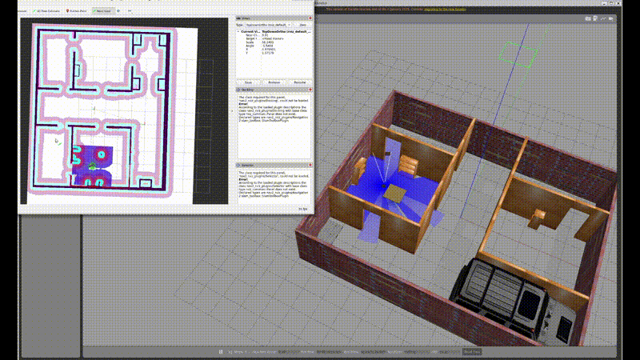
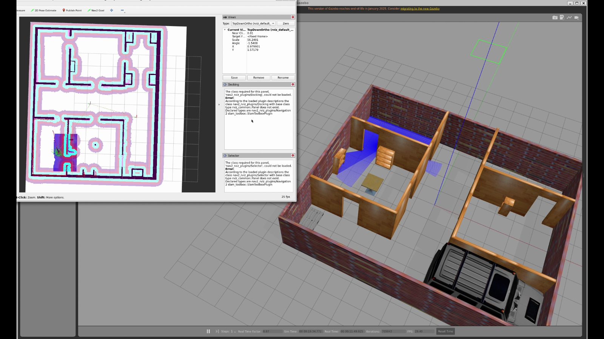

# TurtleBot3 + Nav2 autonomous navigation in a custom Gazebo world

Robotics Software Intern assignment (Antropi Robotics).

**Demo video:** [Watch on Google Drive](https://drive.google.com/file/d/1Dsywo7V6zLqBlb3-BRWh4W5r64kanRJs/view?usp=sharing) (1 min 51 s screen recording, sped up 1.5x)

TurtleBot3 Waffle navigates autonomously through a hand-drawn three-room house in
Gazebo, using the ROS 2 Navigation2 stack with the stock TurtleBot3 parameters (unchanged).
The world was built in the Gazebo Building Editor. The map was generated with Cartographer
and then manually corrected.

## Tested environment

- Ubuntu 22.04 (WSL2), ROS 2 Humble, Gazebo Classic 11.10.2
- TurtleBot3 model: waffle, DDS: CycloneDDS
- Gazebo Classic is end-of-life, but it is the combination the official TurtleBot3 and
  Nav2 tutorials target, so I chose it for reliability.

## Install

    sudo apt install ros-humble-desktop ros-humble-gazebo-ros-pkgs ros-humble-navigation2 \
      ros-humble-nav2-bringup ros-humble-turtlebot3 ros-humble-turtlebot3-gazebo \
      ros-humble-turtlebot3-navigation2 ros-humble-rmw-cyclonedds-cpp \
      python3-colcon-common-extensions

## Build and run

    mkdir -p ~/nav_ws/src && cd ~/nav_ws/src
    git clone https://github.com/shreyas02005-sudo/tb3_nav2_demo.git
    cd ~/nav_ws && colcon build && source install/setup.bash
    export TURTLEBOT3_MODEL=waffle
    export RMW_IMPLEMENTATION=rmw_cyclonedds_cpp
    ros2 launch tb3_nav2_demo demo.launch.py

One command starts Gazebo (custom world), the robot, Nav2 and RViz. The initial pose is
published automatically about 30 seconds after launch. Then click **Nav2 Goal** in RViz.
If the laser scan does not line up with the walls, use **2D Pose Estimate**.
To disable the automatic pose: `set_initial_pose:=false`.

Command-line goal (a point in the middle of a room):

    ros2 action send_goal /navigate_to_pose nav2_msgs/action/NavigateToPose \
      "{pose: {header: {frame_id: map}, pose: {position: {x: -2.9, y: 4.2}, orientation: {w: 1.0}}}}"

## WSL2 tip (optional)

Hardware rendering with an NVIDIA GPU:

    export GALLIUM_DRIVER=d3d12
    export MESA_D3D12_DEFAULT_ADAPTER_NAME=NVIDIA

## Contents

- `launch/demo.launch.py` - starts everything
- `worlds/my_world.world` - the custom world
- `maps/my_world.pgm`, `maps/my_world.yaml` - the navigation map
- `models/` - Gazebo models used by the world (cafe_table, euro_pallet, suv)

## How the map was made

Cartographer SLAM (TurtleBot3 teleop) in this world. The robot flipped once during
mapping and corrupted part of the scan, and a second attempt drifted, so I corrected the
saved map by hand and checked it by comparing the laser scan against the walls in RViz.

## Credits

World built following a Udemy course on ROS 2 Nav2 ("ROS 2 Nav2 [Navigation 2 Stack] -
with SLAM and Navigation"). Navigation uses the standard Nav2 and TurtleBot3 packages.
