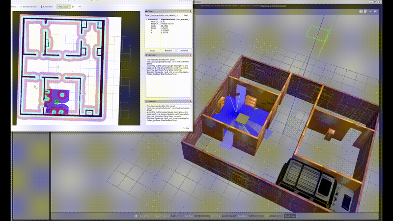
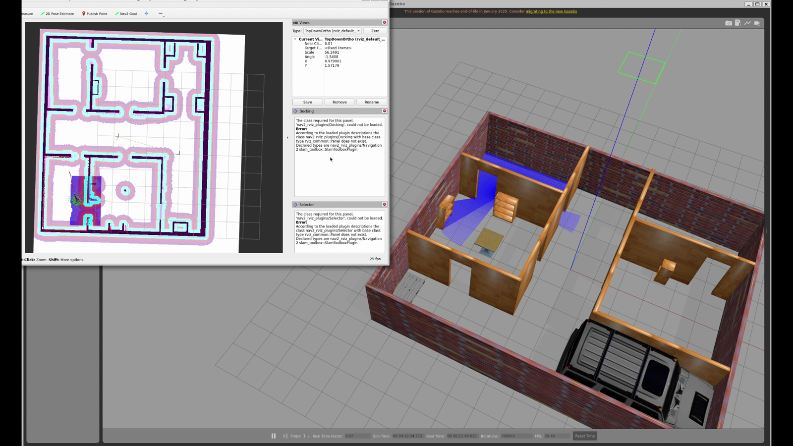
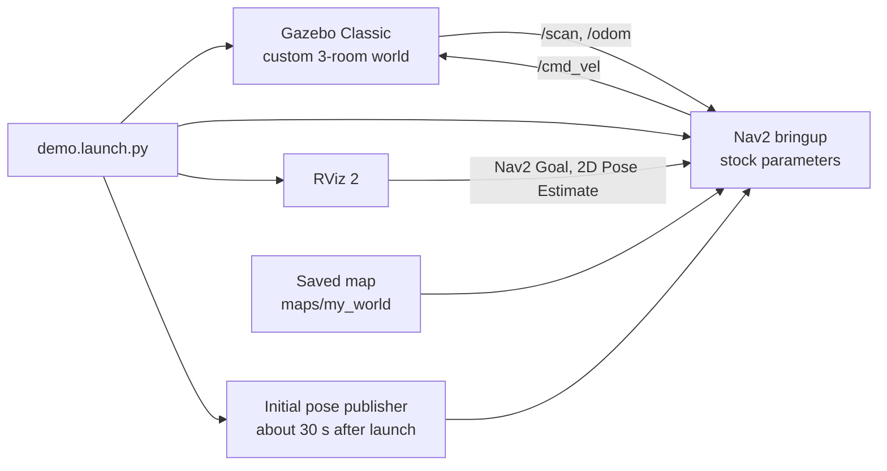
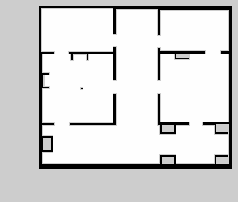

# TurtleBot3 + Nav2 Autonomous Navigation in a Custom Gazebo World


A TurtleBot3 Waffle that navigates on its own around a custom three room house in Gazebo. I designed the world, built the map with Cartographer SLAM, cleaned it up by hand, and wired everything into a single launch file that starts the simulation, Nav2 and RViz together.

**[Watch the demo video](https://drive.google.com/file/d/1Dsywo7V6zLqBlb3-BRWh4W5r64kanRJs/view?usp=sharing)** (1 min 51 s screen recording, sped up 1.5x)



---

## Contents

- [What it does](#what-it-does)
- [How it fits together](#how-it-fits-together)
- [Tested environment](#tested-environment)
- [Install](#install)
- [Build and run](#build-and-run)
- [Sending goals](#sending-goals)
- [The world and the map](#the-world-and-the-map)
- [Repository layout](#repository-layout)
- [Troubleshooting](#troubleshooting)
- [What this project shows](#what-this-project-shows)
- [Limitations and next steps](#limitations-and-next-steps)
- [Acknowledgements](#acknowledgements)
- [License](#license)

---

## What it does

- Starts **Gazebo, the robot, Nav2 and RViz** with one command
- Navigates a **custom three room house** using the ROS 2 Navigation2 stack with its stock parameter sets
- Localises against a **saved occupancy map** that I built with Cartographer and cleaned by hand
- **Sets the initial pose automatically** about 30 seconds after launch, which you can switch off
- Accepts goals from **RViz** (Nav2 Goal) or from the **command line**



## How it fits together



More detail is in [`docs/architecture.md`](docs/architecture.md).

## Tested environment

- Ubuntu 22.04 (WSL2), ROS 2 Humble, Gazebo Classic 11.10.2
- TurtleBot3 model: `waffle`, DDS: CycloneDDS
- Gazebo Classic is end of life, but it's the combination the official TurtleBot3 and Nav2 tutorials target, so I chose it for reliability.

## Install

```bash
sudo apt install ros-humble-desktop ros-humble-gazebo-ros-pkgs ros-humble-navigation2 \
  ros-humble-nav2-bringup ros-humble-turtlebot3 ros-humble-turtlebot3-gazebo \
  ros-humble-turtlebot3-navigation2 ros-humble-rmw-cyclonedds-cpp \
  python3-colcon-common-extensions
```

## Build and run

Clone the repository into your ROS 2 workspace:

```bash
mkdir -p ~/nav_ws/src && cd ~/nav_ws/src
git clone https://github.com/shreyas02005-sudo/tb3_nav2_demo.git
```

Build the workspace and source it:

```bash
source /opt/ros/humble/setup.bash
cd ~/nav_ws && colcon build && source install/setup.bash
```

Set the environment variables and launch:

```bash
export TURTLEBOT3_MODEL=waffle
export RMW_IMPLEMENTATION=rmw_cyclonedds_cpp
ros2 launch tb3_nav2_demo demo.launch.py
```

This one command starts Gazebo (with the custom world), the robot, Nav2 and RViz.

The initial pose is published automatically about 30 seconds after launch. After that, click **Nav2 Goal** in RViz. If the laser scan doesn't line up with the walls, click **2D Pose Estimate** and set the pose yourself.

To turn off the automatic initial pose:

```bash
ros2 launch tb3_nav2_demo demo.launch.py set_initial_pose:=false
```

### WSL2 tip (optional)

If you're running in WSL2 with an NVIDIA GPU, these variables turn on hardware rendering:

```bash
export GALLIUM_DRIVER=d3d12
export MESA_D3D12_DEFAULT_ADAPTER_NAME=NVIDIA
```

## Sending goals

**From RViz:** click **Nav2 Goal**, then click and drag on the map to set the position and direction.

**From the command line:**

```bash
ros2 action send_goal /navigate_to_pose nav2_msgs/action/NavigateToPose \
  "{pose: {header: {frame_id: map}, pose: {position: {x: -2.9, y: 4.2}, orientation: {w: 1.0}}}}"
```

Add `--feedback` to see the distance remaining while the robot drives.

## The world and the map

I designed the house in the **Gazebo Building Editor**. It has several rooms with doorways, so it's a good test of localisation and path planning in tight spaces.

| Navigation map |
|:--:|
|  |

The map started as a Cartographer SLAM run while I drove the robot with the keyboard. Teleoperation caused sensor drift and some odometry resets, so I cleaned the `.pgm` by hand and aligned it against the live laser scan in RViz. That made localisation stable. The full workflow is in [`docs/mapping-workflow.md`](docs/mapping-workflow.md).

## Repository layout

```
.
├── README.md
├── LICENSE
├── CMakeLists.txt
├── package.xml
├── launch/
│   └── demo.launch.py        Starts everything
├── worlds/
│   └── my_world.world        The custom three-room world
├── maps/
│   ├── my_world.pgm          Navigation map (image)
│   └── my_world.yaml         Navigation map (metadata)
├── models/                   Gazebo models: cafe_table, euro_pallet, suv
├── media/                    Demo GIF, screenshot and map preview
└── docs/
    ├── architecture.md       Data flow and launch details
    ├── mapping-workflow.md   How the map was made and cleaned
    └── troubleshooting.md    Known problems and fixes
```

## Troubleshooting

The most common problems:

- **The laser scan doesn't match the walls.** Use **2D Pose Estimate** in RViz.
- **Nothing connects between terminals.** Make sure `RMW_IMPLEMENTATION=rmw_cyclonedds_cpp` is set in every terminal.
- **Gazebo is slow on WSL2.** Try the GPU variables above.

See [`docs/troubleshooting.md`](docs/troubleshooting.md) for more.

## What this project shows

- **Nav2 integration:** bringing up the full navigation stack (map server, localisation, planning, control) on a robot in simulation
- **SLAM and map work:** building a map with Cartographer, then fixing drift and mapping errors by hand against live laser scans
- **Simulation design:** building a custom world in the Gazebo Building Editor and placing models in it
- **Launch engineering:** a single `demo.launch.py` that synchronises Gazebo, the robot state publishers, Nav2 and RViz, plus an automatic initial pose to cut manual setup
- **Environment debugging:** DDS selection, WSL2 GPU rendering and picking a tool combination that's known to work

## Limitations and next steps

- It uses Nav2's stock parameters, so there's been no tuning for this robot and map.
- The map is static, and there are no moving obstacles in the demo.
- Ideas for taking it further:
  - Tune costmap inflation and controller settings for the narrow doorways
  - Run a multi-room patrol with the Nav2 waypoint follower
  - Write a small client that sends goals through the `NavigateToPose` action
  - Add moving obstacles to test dynamic replanning
  - Port the world to a current Gazebo release

## Acknowledgements

Built on [TurtleBot3](https://emanual.robotis.com/docs/en/platform/turtlebot3/overview/) by ROBOTIS, [Nav2](https://docs.nav2.org/), [Cartographer](https://google-cartographer-ros.readthedocs.io/) and [Gazebo](https://classic.gazebosim.org/).

## License

Released under the [Apache License 2.0](LICENSE).
